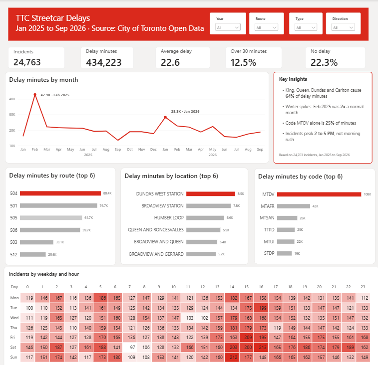
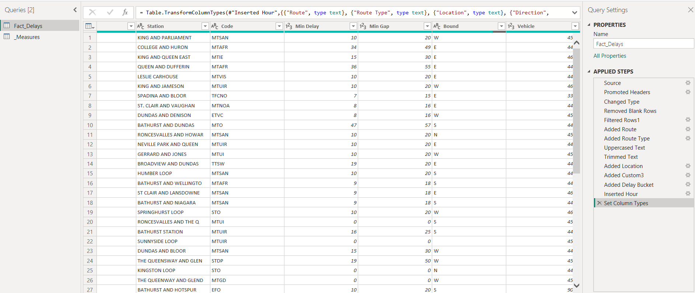
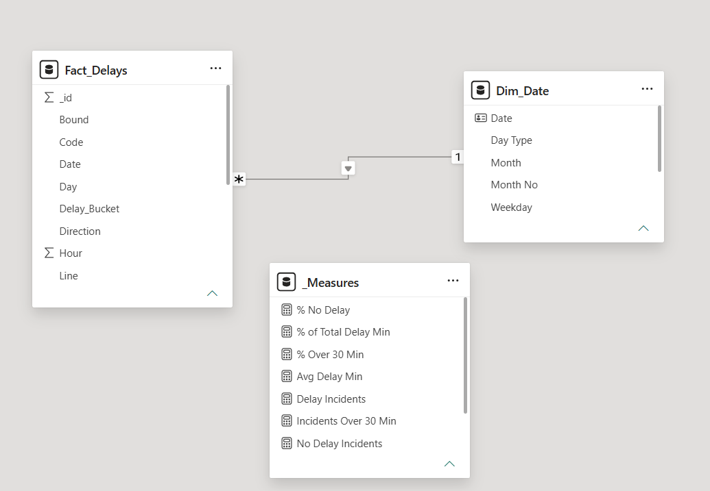
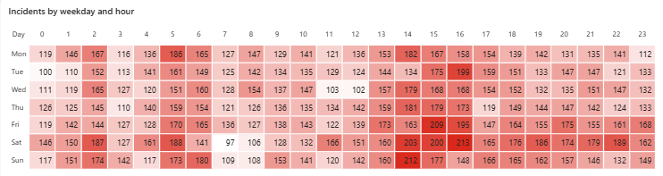
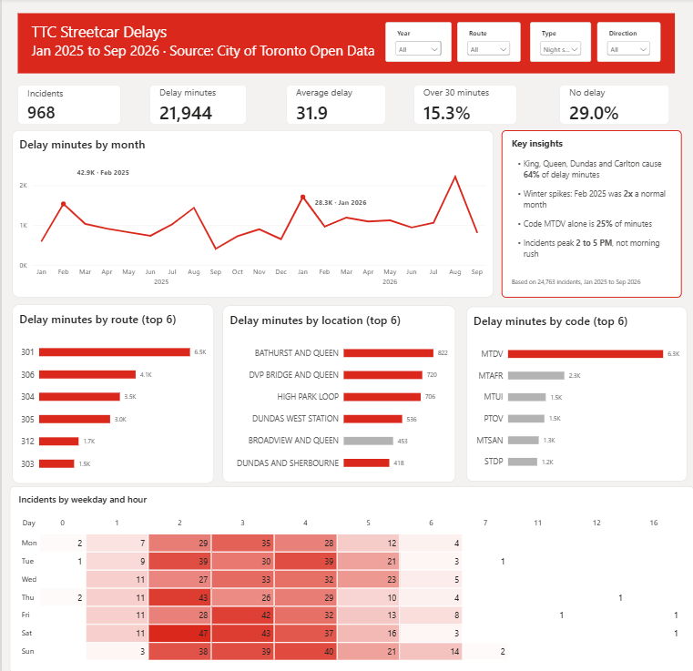

# TTC Streetcar Delay Dashboard (Power BI)

An interactive Power BI dashboard that analyzes **24,763 TTC streetcar delay incidents** in Toronto from January 2025 to September 2026, to find out where, when and why delays happen.

**Companion project:** [Same analysis in Python and SQL](https://github.com/miloniporiya/ttc-streetcar-delay-analysis)



## Business question

Where, when and why do TTC streetcar delays happen, and which ones cost riders the most time?

## Key insights

- **4 routes drive most of the problem.** 504 King, 501 Queen, 505 Dundas and 506 Carlton account for about **64%** of all delay minutes.
- **Winter storms cause the biggest spikes.** February 2025 had **42.9K** delay minutes, about **2x** a typical month, during back-to-back snowstorms. January 2026 was the next highest at 28.3K.
- **One delay code dominates.** Code MTDV alone accounts for about **25%** of all delay minutes (107.6K).
- **Delays cluster at route ends.** The worst locations are subway stations and loops (Dundas West Station, Broadview Station, Humber Loop), not mid-route intersections.
- **Afternoons, not the morning rush.** Incidents peak between **2 and 5 PM**, especially on Fridays and weekends.
- **About 1 in 5 logged incidents (22.3%) caused no delay at all.**

## Recommendations

1. **Focus on the big 4 routes.** Improvements to King, Queen, Dundas and Carlton would have the biggest impact on riders.
2. **Investigate code MTDV first.** It causes a quarter of all lost time, more than any other single cause.
3. **Review operations at stations and loops,** especially turnarounds and crew changes at Dundas West and Broadview.
4. **Plan extra capacity for 2 to 5 PM,** when delays are most frequent.
5. **Strengthen the winter storm response.** One stretch of snowstorms in February 2025 doubled a month's delay minutes.

## Dataset

- **Source:** [TTC Streetcar Delay Data](https://open.toronto.ca/dataset/ttc-streetcar-delay-data/), City of Toronto Open Data
- **Period:** Jan 2025 to Sep 2026
- **Rows:** 24,764 (24,763 after cleaning)
- **Columns:** Date, Line (route), Time, Day, Station (location), Code (delay reason), Min Delay, Min Gap, Bound (direction), Vehicle

## Tools

- Power BI Desktop
- Power Query (M) for data cleaning
- DAX for measures
- Custom JSON theme

## Process

### 1. Data cleaning (Power Query)

| Problem | Fix |
|---|---|
| A 999-minute placeholder delay | Removed |
| `Line` had 204 messy values ("504 KING", "RAD", blanks) | Extracted a clean 3-digit `Route`, plus a Day/Night `Route Type` |
| `Station` had 3,225 values, with the same corner written different ways | Standardized spelling and sorted street names into one `Location` |
| `Bound` had stray values and blanks | Created a clean `Direction` column |
| No time-of-day field | Extracted `Hour` for the heatmap |



### 2. Data model and DAX

A star schema with `Fact_Delays` (one row per incident) linked to a DAX-built `Dim_Date` calendar table.



Some of the key measures:

```DAX
Total Incidents = COUNTROWS ( Fact_Delays )

Avg Delay Min =
DIVIDE ( [Total Delay Min], CALCULATE ( [Total Incidents], Fact_Delays[Min Delay] > 0 ) )

% of Total Delay Min =
DIVIDE ( [Total Delay Min], CALCULATE ( [Total Delay Min], ALLSELECTED ( Fact_Delays ) ) )
```

<details>
<summary>All DAX measures</summary>

```DAX
Total Incidents = COUNTROWS ( Fact_Delays )

Total Delay Min = SUM ( Fact_Delays[Min Delay] )

Delay Incidents = CALCULATE ( [Total Incidents], Fact_Delays[Min Delay] > 0 )

Avg Delay Min = DIVIDE ( [Total Delay Min], [Delay Incidents] )

Incidents Over 30 Min = CALCULATE ( [Total Incidents], Fact_Delays[Min Delay] > 30 )

% Over 30 Min = DIVIDE ( [Incidents Over 30 Min], [Total Incidents] )

No Delay Incidents = CALCULATE ( [Total Incidents], Fact_Delays[Min Delay] = 0 )

% No Delay = DIVIDE ( [No Delay Incidents], [Total Incidents] )

% of Total Delay Min =
DIVIDE ( [Total Delay Min], CALCULATE ( [Total Delay Min], ALLSELECTED ( Fact_Delays ) ) )
```

</details>

### 3. Dashboard

KPI cards, a monthly trend line, top 6 bar charts for routes, locations and delay codes, and a weekday by hour heatmap, all filterable by year, route, route type and direction.

The heatmap is a matrix with gradient conditional formatting, showing which weekday and hour combinations have the most incidents:



## Limitations

- Delay codes (like MTDV) are abbreviations. Joining the TTC delay code reference would show what each one means.
- Locations show where a delay was **recorded**, which isn't always where it started.
- Apart from the single 999-minute placeholder, very long delays (over 300 minutes) were kept. A few of these may be data entry errors and can pull averages up.
- The data shows what happened, not why. Explanations for patterns like weekend peaks are possibilities, not confirmed causes.

## A note on the numbers

The [Python version](https://github.com/miloniporiya/ttc-streetcar-delay-analysis) of this project uses stricter cleaning: it also excludes delays over 300 minutes and non-streetcar vehicles (such as RAD maintenance cars), and leaves 0-minute incidents out of delay calculations. Because of that, some figures differ slightly (for example, MTDV is 25% of delay minutes here and 23.5% there, and 504 King edges out 501 Queen for the most delay minutes here). Both versions point to the same conclusions.

## Repository contents

| File | Description |
|---|---|
| `TTC_Streetcar_Delays.pbix` | Power BI report |
| `TTC_Theme.json` | Custom report theme |
| `images/dashboard.png` | Dashboard screenshot |
| `images/power_query.png` | Power Query cleaning steps |
| `images/data_model.png` | Star schema data model |
| `images/heatmap.png` | Weekday by hour heatmap |
| `images/filtered_night.png` | Dashboard filtered to night streetcars |

## How to use

1. Download and install [Power BI Desktop](https://www.microsoft.com/power-bi/desktop) (free).
2. Open `TTC_Streetcar_Delays.pbix`.
3. Use the slicers at the top to filter by year, route, route type or direction. Every visual updates.

For example, here is the dashboard filtered to night streetcars only:



## Next steps

- Map the delay codes to their official descriptions using the TTC delay code reference
- Add a station map visual
- Compare streetcar delays with the subway and bus delay datasets

## Author

**Miloni Poriya**, Data Analyst | Microsoft Certified: Power BI Data Analyst Associate (PL-300)

[LinkedIn](https://www.linkedin.com/in/miloni-poriya/)
